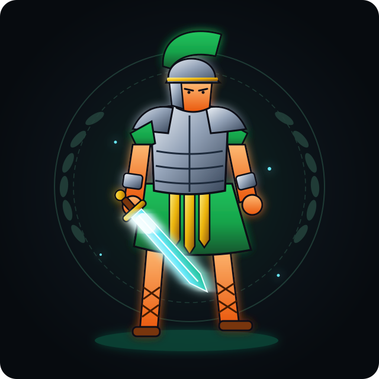

<div align="center">



# Muhammad Soeh Ferdy

### Mahasiswa Teknik Komputer | IoT & Embedded Systems | Web Development

**`NIM: 101032400216`** • **`FOCUS: IoT & Embedded`** • **`WEB: Development`**

*Building smart devices, connecting systems, and turning ideas into useful applications.*

</div>

---

## 👨‍💻 About Me

Hello! I'm **Muhammad Soeh Ferdy**, a Computer Engineering student with a strong interest in **Internet of Things (IoT), embedded systems, and web development**.

I enjoy working across hardware and software — from reading sensor data and programming microcontrollers to connecting devices with dashboards and web-based applications.

- 🔭 **Focus:** IoT, embedded systems, and web development.
- 🌱 **Currently exploring:** Microcontroller programming, MQTT, Node-RED, and IoT dashboards.
- 💻 **Programming:** C and C++.
- ⚙️ **Working style:** Learn by building, testing, troubleshooting, and improving.
- 🎯 **Goal:** Create reliable, useful, and connected technology solutions.

## 🧰 Tech Stack & Tools

<div align="center">

### Programming & Web


### IoT, Embedded & Development Tools


</div>

## 🔌 Areas of Interest

| Area | What I'm exploring |
|---|---|
| **IoT & Embedded Systems** | Microcontrollers, sensors, actuators, device integration |
| **IoT Communication** | MQTT, Wi-Fi connectivity, and data exchange |
| **IoT Dashboard** | Node-RED, real-time monitoring, and web interfaces |
| **Web Development** | Responsive interfaces and application integration |
| **Electronics & Simulation** | Circuit design, testing, and simulation |

## 🚀 Projects

> Replace or add repository links below as your projects become available.

### 🏠 Smart IoT Monitoring System
Sensor-based monitoring using a microcontroller, with data sent to an online or local dashboard.

### 💡 Si Eneng — IoT Rack Finder
An IoT-based rack indicator concept that helps identify item locations using LED indicators and connected data.

### 🌐 IoT Web Dashboard
A web-based interface for displaying device status and sensor readings in a more accessible way.

## 📊 GitHub Statistics

<div align="center">


<br/>


</div>

## 🌱 My Workflow

<div align="center">

**Learn** → **Build** → **Test** → **Improve**

*Understand the concept, make it work, test the result, and keep improving.*

</div>

```cpp
#include <iostream>
using namespace std;

int main() {
    const char* name = "Muhammad Soeh Ferdy";
    const char* focus = "IoT, Embedded Systems, and Web Development";

    cout << "Name: " << name << endl;
    cout << "Focus: " << focus << endl;
    cout << "Status: Always learning and building!" << endl;

    return 0;
}
